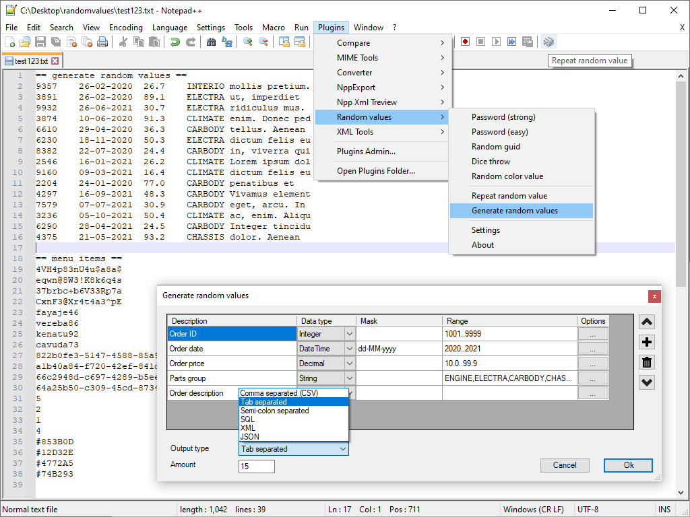

RandomValues - Notepad++ plugin
===============================
     
RandomValues is a plugin for Notepad++ for generating passwords or test data for database and app development, performance testing, designing reports etc.

RandomValues is based on a prototype project [randomdata](http://bdrgames.nl/homepage/files/randomdata.html)

**If you find the Random Values plugin useful you can buy me a coffee!** ☕  

How to install
--------------
The RandomValues plugin is available in the Plugins Admin in Notepad++ v8.1.9.1 or newer.

* In Notepad++ go to menu item `Plugins > Plugins Admin...`
* On tab `Available` search for the plugin named `Random Values`
* Check the checkbox and click the `Install` button
* Click `Yes` to quit Notepad++ and "continue the operations"
* Click `Yes` on the Windows notification "Allow app to make changes"

If you have a Notepad++ version older than v8.1.9.1 or want to install it manually:  
Copy the file [RandomValuesNppPlugin.dll (32bit)](/RandomValuesNppPlugin/bin/Release/)  
to new folder `.\Program Files (x86)\Notepad++\plugins\RandomValuesNppPlugin\RandomValuesNppPlugin.dll`.
For the 64-bit version, it's the same except copy the [RandomValuesNppPlugin.dll (64bit)](/RandomValuesNppPlugin/bin/Release-x64/)  
to `.\Program Files\Notepad++\plugins\RandomValuesNppPlugin\RandomValuesNppPlugin.dll`.

How to use it
-------------

* Select one of the menu items to generate a single random value
* Select "Generate random values" to generate many random values at once.

You can configure the five random value menu items in the menu `Plugins > Random values > settings` under the heading `Menu items`.
Set the first menu item to your preferred random value type (password, GUID, etc.).
Clicking the dice icon in the Notepad++ toolbar will generate a new random value.

Tip: You can customize the 5 menu items in the plugin settings screen, and `MenuItem1` is the default random value when clicking the dice icon in the toolbar, for quick and easy access. To customize a random value, you  can first configure random values in the "Generate random values" screen and test it to see the results. Then go to the settings screen and copy&paste the random-value configuration line from `GenerateCol01` to the `MetnuItem1` entry.

`NOTE: changing the configuration of the menu items requires a restart of Notepad++`

Masks
----------
You can add a mask for the random values, depending on the data type.  
Examples for String text values.

    mask character
    --------------------------------
    A  random vowel (AEIOU)
    B  random consonant (BCDFGHJKLMNPQRSTVWXYZ)
    9  random digit (0123456789)
    F  random hexadecimal digit (0123456789ABCDEF)
    @  random symbol (!@#$%^&*+-)
    X  random letter (vowel or consonant)
    Y  random letter or digit
    Z  random letter or digit or symbol

You can add a mask for the random values, depending on the data type. Here are some examples of using a mask (Note that DateTime masks are case sensitive):

    Data type   Mask           remark
    ---------------------------------------------------------------------
    String      ababab99              For string values, generates "exakir97" etc.
    String      xxxyyyzz99            passwords, see below for extra options `MixMask`, `pwsafe` and `case`
    DateTime    yyyy/MM/dd            datetime values, "2024/12/31" etc.
    DateTime    dd-MM-yyyy HH:mm:ss   datetime values, "31-12-2024 23:59:59" etc.
    DateTime    HH:mm:ss              datetime values, just the time part
    Integer     -                     no mask supported
    Decimal     -                     no mask supported

Note, for generating passwords there are additional options in the generate random values screen.
Enable `Mix mask` to randomize the order of the mask characters for each generated value.
Enable `Password safe char` and the resulting values won't include any `i, o, g, l, s, z, 0, 1, 2, 5, 9` characters.
Change the `case` option to lowercase, uppercase, mixed-case (random) or InitCap, the last option capitalizes the first letter.

If no mask is configured for a String value, it will generate random snippets from the Lorem Ipsum text.

Ranges
------
You can set a minimum/maximum range by specifying two values separated by `..`, or a discrete set of values separated by `,`  
Examples of ranges for integer values 

    1..20            Random integer from 1 up to and including 20
    100..999         Random integer from 100 up to and including 999
    1,2,3,4,5,6      Random value between 1 and 6

Examples of ranges for date values

    2023..2024                Random date value between 2023-01-01 up to and including 2024-12-31
    2023-06..2024-04          Random date value between 2023-06-01 up to and including 2024-04-30
    2023-06-01..2023-07-01    Random date value between 2023-06-01 up to and including 2023-07-01
    2023..2023                Random date value between 2023-01-01 up to and including 2023-12-31

Examples of ranges for string values

    0,1,9            Random value 0, 1 or 9
    Low,Medium,High  Random code value "Low", "Medium" or "High"
    M,F              Random character M or F
    M,M,M,F,F        Random character M or F, but M/F will be approx. 60%/40%

Roadmap/goals
-------------
The RandomValues plugin is pretty much finished for now, but here is a list of features that could be added (~~strikethrough~~ is done)

* ~~random values based on masks~~
* ~~generate single random value~~
* ~~generate multiple values at once~~
* ~~different output formats, csv, SQL, xml, json etc.~~
* support word lists in settings (can also be done using sets?)
* ~~additional mask options uppercase/mixed case (for passwords)~~
* ~~option; limit to minimum/maximum values~~
* option; take x values from a set of values (needed? can also be done using sets)
* output xml, also path support? @properties etc. maybe?
* replace values in csv format, replace only in column X (too specific, really needed?)
* replace regex? is this needed? can also use default Notepad++ regex search + generate value

Troubleshooting and tips
------------------------
When generating lots of random passwords, it's not guaranteed that all values will be unique.

When generating lots of random data the plugin can take a while to complete
and Notepad++ can become temporarily unresponsive, for example 1000000 records
will take a couple of seconds.

Masks are not supported for data types Integer and Decimal.

You can further customize random values for example by defining two separate
columns `ABC,DEF,XYZ` and `100..999`, and then combining (concatenating) the
two values by removing the column separator, using the default Notepad++
search and replace function.

If you want even more customization options than what is possible with the
Random Values plugin, then you can adapt or expand this Python script
[random_values.py](/random_values.py)  

Acknowledgements
----------------
With thanks to:

* kbilsted for providing the excellent
[NotepadPlusPlusPluginPack.Net](https://github.com/kbilsted/NotepadPlusPlusPluginPack.Net)
* Members of the [Notepad++ plugin development community](https://community.notepad-plus-plus.org/category/5/plugin-development)
* Anyone who shared their [plugin on GitHub](https://github.com/search?l=C%23&o=desc&q=notepad%2B%2B+plug&s=stars&type=Repositories)

The Random Values plugin couldn't have been created without their source examples and suggestions.

Disclaimer
----------
This software is free-to-use and it is provided as-is without warranty of any kind.

History
-------
11-jul-2021 - first release upload to github  
24-oct-2021 - v0.2 Various bug fixes and added to Plugins Admin  
13-nov-2021 - v0.2.1 Fluent UI icons, extra SQL options, various bug fixes  
17-dec-2023 - v0.3 PostgreSQL support, toolbar icon updated, various bug fixes  

BdR©2026 Free to use - send questions or comments: Bas de Reuver - bdr1976@gmail.com

